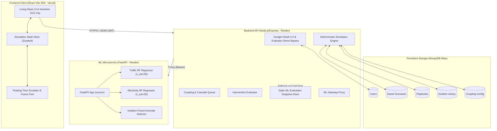

# CitySync: Technical Design Document (Remediated)

* **Author:** Yograj D
* **Status:** In Review (GATE 3)
* **Date:** 2026-11-17
* **Review Cycle:** Round 1 Resolution (EGM Multi-Lens Remediation Applied)

---

## 1. Overview & Problem Statement

Urban infrastructure systems—road traffic, electrical power, and municipal water—operate as interdependent networks. A localized disturbance (e.g., extreme heat, traffic congestion, or water main ruptures) rapidly cascades across boundaries. CitySync provides an integrated, transparent decision-support platform that simulates these interconnections, detects impending breaches, evaluates counter-measures, and delivers actionable recommendations with human-centric impact metrics.

---

## 2. Goals & Non-Goals

### 2.1 Goals
- **Deterministic 24-Node Simulation:** Model 8 distinct urban zones across Traffic, Electricity, and Water in discrete 5-minute ticks ($\Delta t = 5\text{ min}$, 288 steps/day) with reproducible state $S(t) = f(\text{seed}, t, \text{events}, \text{interventions})$.
- **Coupling Propagation with Quantized Lags:** Model cross-domain effects with integer tick lags ($\tau \in \{5, 10, 15\}\text{ min}$).
- **Decision Support:** Provide early warning threshold forecasts, cascade tracing with root-cause analysis (Why Panels), and ranked intervention simulations showing Stability Index improvement and residents protected.
- **Trained Classical ML Layer:** Dedicated Python FastAPI microservice housing Random Forest regressors and Isolation Forest anomaly detectors trained on real/calibrated data, benchmarked against persistence and seasonal naive baselines.
- **Living Glass Design System:** Dynamic glassmorphic interface with reactive background gradients, 3D isometric SVG city grid with 2D fallback, and full iPhone Safari compliance.
- **Strict Data Honesty:** Uniform labeling using three distinct badges (`Simulated`, `Rule-based`, `Trained ML`).
- **Demo & Evaluation Safety:** Google OAuth 2.0 with one-time frontend code exchange, supplemented by an instant one-click "Evaluator / Demo Login" to guarantee zero login failure during hackathon judging.

### 2.2 Non-Goals
- No external generative AI / LLM APIs (zero dependency on OpenAI, Anthropic, or Gemini runtime keys).
- No stateful WebSockets (pure stateless REST engine with pre-computed daily step caches).
- No arbitrary ungrounded real-world accuracy claims for synthetic streams.

---

## 3. High-Level Architecture & Communication Flow



### 3.1 Dual Render Cold-Start Mitigation
To prevent 504 Gateway Timeouts when Render free-tier instances sleep:
1. **Pre-computed Evaluation Snapshots:** The training pipeline compiles test actuals, predictions, intervals, and model metrics into `backend/src/data/evaluation_snapshot.json`. The Express backend serves `/api/ml/evaluation/:model` and `/api/ml/models` directly from this snapshot if the FastAPI service is sleeping.
2. **Background Wake-Up:** Upon frontend authentication, Express triggers an asynchronous non-blocking GET to the ML service's `/health` endpoint to initiate spin-up.
3. **Graceful UI Degradation:** The frontend displays a friendly indicator ("*Live ML Engine warming up; displaying validated training snapshot*") rather than failing with an error.

---

## 4. Data Models (MongoDB Atlas / Mongoose)

### 4.1 `User`
```typescript
interface IUser {
  googleId?: string;
  isGuestDemo?: boolean;
  email: string;
  name: string;
  avatar: string;
  role: 'user' | 'admin';
  themePreference: 'light' | 'dark' | 'system';
  createdAt: Date;
  updatedAt: Date;
}
```

### 4.2 `SavedScenario`
```typescript
interface ISavedScenario {
  name: string;
  description?: string;
  ownerId: mongoose.Types.ObjectId;
  seed: number;
  activeEvents: Array<{
    type: 'heatwave' | 'stadium_event' | 'road_closure' | 'substation_outage' | 'pipe_burst' | 'rain';
    zoneId: string;
    severity: number; // 0.0 to 1.0
    startStep: number; // 0 to 287
    durationSteps: number; // integer ticks
  }>;
  summaryMetrics: {
    baselineStability: number;
    scenarioStability: number;
    nodesInCritical: number;
    residentsAffected: number;
  };
  createdAt: Date;
}
```

### 4.3 `RecommendationRun`
```typescript
interface IRecommendationRun {
  scenarioId?: mongoose.Types.ObjectId;
  ownerId: mongoose.Types.ObjectId;
  timestamp: Date;
  candidates: Array<{
    actionId: string;
    name: string;
    targetZone: string;
    system: 'traffic' | 'electricity' | 'water';
    description: string;
    deltaStability: number;
    nodesSavedFromCritical: number;
    residentsHelped: number;
    rank: number;
  }>;
}
```

### 4.4 `CouplingConfig`
```typescript
interface ICouplingLink {
  sourceSystem: 'traffic' | 'electricity' | 'water';
  targetSystem: 'traffic' | 'electricity' | 'water';
  scope: 'intra_zone' | 'inter_zone';
  weight: number; // 0.0 to 1.0
  lagMinutes: number; // 5, 10, or 15 (multiples of 5 min)
  thresholdTrigger: number; // 0 to 100 stress threshold
}
```

---

## 5. Deterministic Simulation Engine & Coupling Mathematics

### 5.1 City Topology & Spatial Adjacency Matrix
8 Zones with synthetic resident populations:
- **Downtown (POP: 85,000):** High commercial electricity, dense road network.
- **Tech Park (POP: 65,000):** High daytime power, peak commuter traffic.
- **Residential North (POP: 110,000):** High residential water & evening power.
- **Residential South (POP: 95,000):** Suburban commuting, steady water usage.
- **Industrial Estate (POP: 30,000):** Heavy continuous electricity & water demand.
- **Stadium District (POP: 45,000):** Intermittent massive event spikes.
- **Old Town (POP: 75,000):** Narrow roads, fragile water piping.
- **Port & Airport (POP: 25,000):** Continuous logistics baseline.

**Spatial Adjacency Graph (for Road Spillover and Water Pressure Gradients):**
```json
{
  "Downtown": ["Old Town", "Tech Park", "Residential North"],
  "Tech Park": ["Downtown", "Residential South", "Industrial Estate"],
  "Residential North": ["Downtown", "Old Town", "Stadium District"],
  "Residential South": ["Tech Park", "Industrial Estate", "Port & Airport"],
  "Industrial Estate": ["Tech Park", "Residential South", "Port & Airport"],
  "Stadium District": ["Residential North", "Old Town"],
  "Old Town": ["Downtown", "Residential North", "Stadium District"],
  "Port & Airport": ["Industrial Estate", "Residential South"]
}
```

### 5.2 Node State & Mathematically Normalized Stress
Total Nodes: $8 \text{ zones} \times 3 \text{ systems} = 24 \text{ nodes}$.
Each node $i \in \{1 \dots 24\}$ has nominal baseline capacity $C_i$ (normalized to 100 units).
- **Traffic:** Measured as road congestion volume $D_{\text{traffic}, z}(t)$. Stress $S_{\text{traffic}, z} = \min(100, \frac{D_{\text{traffic}, z}}{C_{\text{traffic}, z}} \times 100)$.
- **Electricity:** Measured as substation electrical load $D_{\text{power}, z}(t)$. Stress $S_{\text{power}, z} = \min(100, \frac{D_{\text{power}, z}}{C_{\text{power}, z}} \times 100)$.
- **Water:** Measured as pumping delivery pressure $P_{\text{water}, z}(t) \in [0, 100]\%$. Stress is inversely proportional to pressure:
  $$S_{\text{water}, z}(t) = \max(0, 100 - P_{\text{water}, z}(t))$$

**Normalized City Stability Index (Guaranteed $[0, 100]$ Invariant):**
$$\text{Stability}(t) = 100 \times \left(1 - \frac{\sum_{i=1}^{24} S_i(t) \cdot w_i}{\sum_{i=1}^{24} 100 \cdot w_i}\right) = 100 - \frac{\sum_{i=1}^{24} S_i(t) \cdot w_i}{26.4}$$
where $w_{\text{traffic}} = 1.0$, $w_{\text{power}} = 1.2$, $w_{\text{water}} = 1.1$, and the total sum of weights $\sum_{i=1}^{24} w_i = 8 \times (1.0 + 1.2 + 1.1) = 26.4$.
- When all $S_i = 0 \implies \text{Stability} = 100.0$
- When all $S_i = 100 \implies \text{Stability} = 100 - \frac{2640}{26.4} = 0.0$

### 5.3 Quantized Coupling Propagation Rules
All time delays $\tau$ are strictly quantized to integer 5-minute ticks ($\Delta t = 5\text{ min}$):
1. **Heatwave Impact:** Adds $+0.35 \times C_{\text{power}}$ to electricity demand and drops water pressure by $0.20 \times P_{\text{water}}$ immediately ($\tau = 0$).
2. **Traffic Spillover:** If $S_{\text{traffic}, z} > 60$, spill $0.35 \times (S_{\text{traffic}, z} - 60)$ divided equally among neighboring adjacent zones with lag $\tau = 10\text{ min}$ (2 ticks).
3. **Power Overload $\to$ Traffic Signals:** If $S_{\text{power}, z} > 75$, signal degradation causes $D_{\text{traffic}, z} \mathrel{+}= 0.25 \times C_{\text{traffic}}$ with lag $\tau = 10\text{ min}$ (2 ticks).
4. **Power Overload $\to$ Water Pumps:** If $S_{\text{power}, z} > 80$, pump efficiency collapses, reducing $P_{\text{water}, z}$ by $35\%$ with lag $\tau = 15\text{ min}$ (3 ticks).
5. **Low Pressure $\to$ Auxiliary Electrical Demand:** If $S_{\text{water}, z} > 70$ (pressure $< 30\%$), backup auxiliary booster pumps trigger, adding $+0.15 \times C_{\text{power}}$ with lag $\tau = 5\text{ min}$ (1 tick).

---

## 6. REST API Specifications (Express Gateway)

### 6.1 Authentication Endpoints
- `GET /api/auth/google`: Initiates Google OAuth2.
- `GET /api/auth/google/callback`: Issues short-lived one-time exchange code.
- `POST /api/auth/exchange`:
  - Request: `{ code: string }`
  - Response: `{ token: string, user: IUser }`
- `POST /api/auth/demo-login`: Instant evaluator bypass.
  - Response: `{ token: string, user: IUser }`

### 6.2 Simulation Contracts
- `GET /api/simulation/state?step=N`:
  - Response:
    ```typescript
    {
      step: number; // 0..287 (5-min intervals)
      timeFormatted: string; // "14:35"
      stabilityIndex: number; // 0.0..100.0
      nodesInCritical: number;
      nodesInWarning: number;
      zones: Array<{
        zoneId: string;
        name: string;
        traffic: { demand: number; capacity: number; stress: number };
        electricity: { demand: number; capacity: number; stress: number };
        water: { pressure: number; stress: number };
      }>;
      activeAlerts: Array<{
        id: string;
        zoneId: string;
        system: 'traffic' | 'electricity' | 'water';
        severity: 'warning' | 'critical';
        message: string;
        whyChain: string[];
      }>;
    }
    ```

- `POST /api/simulation/forecast`:
  - Request: `{ currentStep: number, horizonSteps: 24, activeEvents: ISavedScenario['activeEvents'] }`
  - Response:
    ```typescript
    {
      forecasts: Array<{
        nodeId: string;
        zoneId: string;
        system: 'traffic' | 'electricity' | 'water';
        baselineStress: number[];
        predictedStress: number[];
        timeToBreachMinutes: number | null;
        badge: 'Simulated' | 'Rule-based' | 'Trained ML';
      }>;
    }
    ```

- `POST /api/recommendations/evaluate`:
  - Request: `{ step: number, scenarioEvents: ISavedScenario['activeEvents'] }`
  - Response:
    ```typescript
    {
      recommendations: Array<{
        actionId: string;
        title: string;
        targetZone: string;
        system: 'traffic' | 'electricity' | 'water';
        description: string;
        currentStability: number;
        projectedStability: number;
        deltaStability: number;
        nodesSavedFromCritical: number;
        residentsHelped: number;
        rank: number;
      }>;
    }
    ```

---

## 7. Machine Learning Pipeline & Strict Data Governance (`backend/ml`)

### 7.1 Architecture & Guardrails
- **Service:** Python 3.11 FastAPI service (`uvicorn`) on Render.
- **Memory Footprint:** Models constrained to `n_estimators = 50`, `max_depth = 10`, `n_jobs = 1` to guarantee sub-150MB RAM usage.
- **Zero Leakage Invariant:** All lag and rolling calculations utilize trailing windows exclusively (`closed='left'`):
  $$\text{feat\_rolling\_mean}_{t} = \frac{1}{W} \sum_{k=1}^{W} y_{t-k}$$
- **Chronological Split:** Train: 70%, Validation: 15%, Test: 15%. Strict temporal order (no randomized train_test_split).

### 7.2 Dataset Registry & Provenance
1. **Traffic Congestion Model:**
   - Source: Bengaluru Traffic Police (BTP) on OpenCity (hourly congestion in km).
   - Target: Continuous congestion index $[0, 100]$.
   - Covariates: Hour sine/cosine, Day-of-week, Weekend flag, Lag-1h, Lag-24h, Lag-168h, Open-Meteo hourly precipitation & temperature.
   - Badge: `Trained ML` with `Real Data` chip.
2. **Electricity Demand Model:**
   - Source: Karnataka State Load Despatch Centre (Karnataka SLDC) / BESCOM (Bangalore Electricity Supply Company Limited) 15-minute load + Open-Meteo temperature.
   - Target: Substation electrical load.
   - Badge: `Trained ML` with `Real Data` chip (or `Trained on simulated data` if SLDC CSV is absent).
3. **Water Pressure Model:**
   - Source: Calibrated synthetic generator from simulator.
   - Badge: `Trained on simulated data: measures fidelity to simulator, not real world`.
4. **Anomaly Detection:**
   - Algorithm: Isolation Forest (`contamination = 0.03`).
   - Ground Truth Labels: Present only for synthetic injected incidents. Unlabeled periods report anomaly rate and score only.

---

## 8. Page-by-Page Frontend Structure (Unified & Responsive)

To deliver high craft and maintainability, the UI is organized into 4 primary views + 1 public authentication view:

1. **Login Page (`/login`):**
   - Full-screen glass card with Living Glass breathing background.
   - "Continue with Google" primary action + **"Evaluator / Demo Mode"** quick-access button.
   - Theme toggle (Light/Dark/System) and simulated city badge.
2. **City Operations Center (`/` - Dashboard):**
   - Top KPI glass row (Stability Index, Critical Count, Warning Count, Next Predicted Breach).
   - **Isometric SVG City Grid** with 3D glass towers and real-time stress glow (with automatic 2D flat-grid fallback for reduced motion / mobile).
   - **Ripple Engine Overlay:** Animated SVG pulse spreading across interconnections.
   - **Floating Time Scrubber:** Drag across 24h timeline with play/pause and 1x/5x/20x speed.
   - **Live Alert Feed with Why Panels:** Expandable root-cause backtrackers showing coupling delays in minutes.
3. **Scenario Lab & Future Fork (`/scenario-lab`):**
   - Event injection console (Heatwave, Stadium Event, Road Closure, Pipe Burst) with zone selectors and severity sliders.
   - **Future Fork View:** Dual-lane scrubber comparing Baseline vs. Mitigated scenario.
   - **Interconnection Dependency Graph:** 24-node interactive network view with system filters (Traffic/Power/Water).
   - **Ranked Recommendations Bar:** Instant simulation of counter-measures with before/after stability charts.
4. **Transparency & Resilience Hub (`/transparency`):**
   - **Model Info Sub-tab:** Live model cards, actual-versus-predicted test charts, $R^2$/MAE comparisons vs. naive baselines, and uncertainty envelopes.
   - **Weak Link Finder Sub-tab:** Ranked single points of failure and zone resilience scores.
   - **Coupling Assumptions Sub-tab:** Complete transparent rule table (cause, effect, weight, lag); admin editable.
5. **Decision Brief & Playbooks (`/brief`):**
   - Print-friendly Mayor's Briefing with one-click "Print / Save as PDF".
   - Saved playbook runner.
6. **Profile & Settings (`/settings`):**
   - Account info, theme switcher, and session sign-out.

---

## 9. File-by-File Repository Layout

```text
CitySync/
├── concepts_brief.md
├── design_draft.md
├── backend/
│   ├── package.json
│   ├── .env.example
│   ├── src/
│   │   ├── index.js
│   │   ├── config/ (db.js, passport.js, env.js)
│   │   ├── middleware/ (auth.js, rateLimiter.js, errorHandler.js)
│   │   ├── models/ (User.js, Scenario.js, Playbook.js, Coupling.js, Incident.js)
│   │   ├── routes/ (auth.js, simulation.js, scenarios.js, recommendations.js, ml.js)
│   │   ├── engine/
│   │   │   ├── cityConfig.js (8 zones, capacities, population, adjacency)
│   │   │   ├── simulationEngine.js (deterministic 288-step calculation & cache)
│   │   │   ├── couplingModel.js (quantized lags, propagation rules)
│   │   │   ├── forecastBaseline.js (statistical 2-hour trend)
│   │   │   └── interventions.js (ranking & delta stability logic)
│   │   └── data/ (seed.js, evaluation_snapshot.json, incidentLibrary.json)
│   └── ml/
│       ├── .python-version
│       ├── requirements.txt
│       ├── requirements-serve.txt
│       ├── serve.py (FastAPI microservice: /predict, /models, /evaluation, /health)
│       ├── train.py (End-to-end retraining script with fixed seed)
│       ├── pipeline/
│       │   ├── registry.py (Dataset definitions & schemas)
│       │   ├── preprocessing.py (Chronological splits, trailing lag features)
│       │   └── models.py (RandomForest, IsolationForest, Baselines)
│       ├── artifacts/ (joblib binaries, metadata.json, evaluation_snapshot.json)
│       └── tests/ (test_leakage.py, test_api_contracts.py)
└── frontend/
    ├── package.json
    ├── vite.config.js
    ├── tailwind.config.js
    ├── index.html
    ├── src/
    │   ├── main.jsx
    │   ├── App.jsx
    │   ├── api/ (client.js, simulation.js, ml.js, auth.js)
    │   ├── context/ (AuthContext.jsx, SimulationContext.jsx, ThemeContext.jsx)
    │   ├── components/
    │   │   ├── common/ (GlassCard.jsx, Badge.jsx, Button.jsx, Skeleton.jsx, Toast.jsx)
    │   │   ├── layout/ (Sidebar.jsx, MobileNavbar.jsx, Header.jsx, LivingBackground.jsx)
    │   │   ├── map/ (IsometricCity.jsx, FlatGridCity.jsx, ZoneDrawer.jsx, RippleOverlay.jsx)
    │   │   ├── graph/ (DependencyGraph.jsx, CascadeReplayer.jsx)
    │   │   ├── controls/ (TimeScrubber.jsx, FutureForkControls.jsx, CommandBar.jsx)
    │   │   └── widgets/ (WhyPanel.jsx, PulseLine.jsx, ActualVsPredictedChart.jsx)
    │   └── pages/
    │       ├── Login.jsx
    │       ├── Dashboard.jsx
    │       ├── ScenarioLab.jsx
    │       ├── TransparencyHub.jsx
    │       ├── DecisionBrief.jsx
    │       └── Settings.jsx
```

---

## 10. iPhone Safari & Living Glass Implementation

- **Viewport & Dynamic Units:** `<meta name="viewport" content="width=device-width, initial-scale=1, viewport-fit=cover">`. Primary container utilizes `min-h-[100dvh]` and `p-[env(safe-area-inset-top)_env(safe-area-inset-right)_env(safe-area-inset-bottom)_env(safe-area-inset-left)]`.
- **Safari CSS Backdrop Blur:** `backdrop-filter: blur(20px) saturate(140%); -webkit-backdrop-filter: blur(20px) saturate(140%);`. Fallback: `@supports not (backdrop-filter: blur(20px))` defaults to 92% opaque surfaces.
- **Touch & Zoom Guardrails:** Text inputs and select fields set to `font-size: 16px` to prevent Safari auto-zoom on focus. Minimum 44x44px touch targets.
- **Hardware Acceleration:** Max 2 stacked blurred layers visible in any viewport. Animations constrained strictly to `transform` and `opacity`.

---

## 11. Critical User Journeys (CUJs)

### CUJ 1: Baseline to Crisis to Mitigated Future Fork
1. **Given:** User is logged in via Google OAuth or Evaluator Demo Mode; Dashboard clock is at $t=14:00$; City Stability is $88.5/100$.
2. **When:** User navigates to Scenario Lab, injects a Heatwave ($0.8$ severity) and Stadium Event in Stadium District, and clicks "Simulate".
3. **Then:**
   - Ripple Engine animates stress spreading along coupling links into Downtown in real time.
   - Stability Index drops to $44.2$; Why Panel details the root causes (Substation 3 overload $\to$ signal failure in 10 min $\to$ road gridlock).
   - Future Fork splits into Baseline (disaster) vs. Intervention Lane (stability restored to $79.1$, saving 42,000 residents).

### CUJ 2: ML Model Transparency Verification
1. **Given:** User opens `/transparency` and selects the Traffic Random Forest model card.
2. **When:** User toggles between "Held-out Test Evaluation" and "Training Metadata".
3. **Then:**
   - Client displays live training metadata (BTP OpenCity citation, 70/15/15 chronological split, $R^2$, MAE vs. persistence baseline).
   - Actual-versus-predicted curve displays the held-out test evaluation with uncertainty envelope.
   - Stream carries the clear `Trained ML` badge alongside the `Real Data` source chip.
